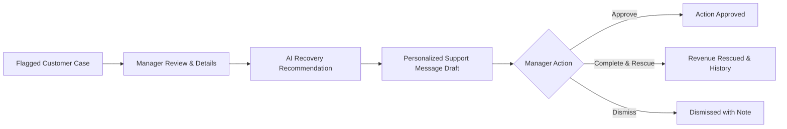

# 🛡️ ShopSync RescueOps
### *Customer Risk & E-Commerce Order Recovery Engine*

[](https://nextjs.org)
[](https://www.typescriptlang.org)
[](https://tailwindcss.com)
[](https://aistudio.google.com)
[](LICENSE)

---

## 📌 1. The Core Problem
Modern direct-to-consumer (DTC) brands and multi-channel retailers lose high-value customers and significant revenue to **silent checkout failures and sync discrepancies**:
- **Phantom Stockouts**: Race conditions or API rate limits falsely show in-stock items as "Sold Out" during checkout.
- **Dropped Webhooks**: Customer payments succeed on Stripe, but webhook drops leave orders in unfulfilled limbo.
- **Checkout Stalls**: Third-party tax or shipping API timeouts disable order submission buttons.
- **Biometric Drop-offs**: Mobile bank 3DS verification prompts expire, abandoning high-intent buyers.

Store managers typically discover these lost customers hours or days later—usually only when an angry customer files a complaint or chargeback.

---

## 💡 2. The Solution: A Clean Customer Recovery Workflow
**ShopSync RescueOps** provides a focused, actionable operations command center for store managers:



### The 6-Step Workflow:
1. **Focused Dashboard**: Real-time summary of 4 key metrics:
   - **Customers Needing Attention**
   - **High-Risk Cases**
   - **Pending Actions**
   - **Recovered Revenue**
2. **Customer Risk Queue**: Clean, readable table displaying customer name, channel badge, order ID, items, cart value, and exact reason flagged.
3. **Customer Details Drawer**: Deep dive into why the customer was flagged with clear, human-readable evidence—no raw unformatted JSON or technical clutter.
4. **AI Recommendations**: Explains the practical next-best recovery action and provides an **editable personalized customer message draft** (powered by Gemini AI or a rule-based engine).
5. **Manager Review & Action**: Store managers can **Approve**, **Complete**, or **Dismiss** cases with immediate status updates.
6. **Action History**: Dedicated audit log tracking all previously completed or dismissed actions, customer names, actions taken, and recovered values.

---

## 🛠️ 3. Quickstart & Installation

### Prerequisites
- Node.js 18+ (Tested on Node.js v24)
- npm

### 1. Installation
```bash
git clone https://github.com/your-username/shopsync-rescueops.git
cd "ShopSync RescueOps"
npm install
```

### 2. Configure Environment Variables (Optional)
```bash
cp .env.example .env.local
```
Add your free Google AI Studio API key if you want cloud Gemini AI:
```env
GEMINI_API_KEY=your_gemini_api_key_here
```
> **Note**: If left blank, the application automatically runs in **Rule-Based Smart Recovery Mode**. All customer recommendations, message drafts, and workflows remain 100% functional!

### 3. Start Development Server
```bash
npm run dev
```
Open **[http://localhost:3000](http://localhost:3000)** in your browser.

### 4. Build for Production
```bash
npm run build
npm start
```

---

<<<<<<< HEAD
## 🧪 4. Live Hackathon Demo Walkthrough

1. **Dashboard Overview**: Show the 4 concise manager metrics at the top.
2. **Review a Flagged Customer**:
   - In the **Flagged Customers** queue, click **"Review & Act"** on **Elena Vance** (Nike Air Zoom Pegasus, $1,420, High Risk).
   - In the drawer, point out:
     - **Why Flagged**: Inventory locked during checkout due to sync lag.
     - **Evidence**: 3 checkout attempts in 4 minutes; 18 units verified in warehouse.
     - **AI Recommendation**: One-Click Reserved Checkout with 10% Loyalty Courtesy.
     - **Editable Support Draft**: Ready-to-copy customer email/SMS.
3. **Take Action**:
   - Click **"Approve Action"** or **"Mark as Completed"**.
   - Watch celebratory confetti trigger and **Recovered Revenue** update instantly.
4. **Inspect History**:
   - Switch to the **"Action History"** tab in the navbar.
   - Show the newly recorded entry with timestamp, action taken, and recovered dollar value.
5. **Simulate a New Case**:
   - Click **"Simulate Case"** in the top bar.
   - Click **"Inject Case"** on *Chloe Simmons* (Stripe unfulfilled order).
   - Notice the case immediately appears in the queue ready for review.

---
=======

>>>>>>> a032d83a4b61b5ac2ad1b36572a597c6aeb2c70a

## 📄 License
MIT License - see [LICENSE](LICENSE) for details.
